  

  

  
  
  
  
  
  
  

---

Infrastructure and self-hosting at LynxFlow. My job is the boring middle layer:
the boxes that run other boxes, the backups nobody tests, the cron jobs that have
been green for eleven months and might not be doing anything.

I am not a platform-engineering evangelist. Most of what I run is a handful of
small VPSes and one machine at home, and the main constraint is that there is no
one to page at 3 a.m. except me. So I optimise for systems that tell me the truth
without supervision, and for scripts that fail loudly instead of quietly doing
nothing.

---

### What I work on

**Container hygiene.**
Compose files, image pinning, volume ownership, log rotation. The failure that
moved me to write linting tools was a `docker system prune` that deleted a volume
still mounted by a stopped container — the daemon considered it unused, and the
stack came back up with an empty database and no error.

**Backups that get restored.**
A backup counts when a file comes out of it byte-identical. Everything else is
faith. I run restic, check it against a rotating subset, and restore one file a
week and compare hashes. The tooling here is the wrapper that makes those three
things one cron line instead of three that drift apart.

**Certificates and disk.**
The two things that take a self-hosted box offline are a certificate that
expired and a disk that filled. Both are detectable days in advance, which means
both are avoidable, which means the only interesting engineering is making the
detection impossible to silence.

**Boring alerting.**
Exit codes, systemd timers, and one Telegram message that only fires on failure.
No dashboard to check. If I have to look at a graph to know whether something is
alive, the monitoring is wrong.

---

### Selected projects

**[compose-doctor](https://github.com/Lyn231231/compose-doctor)**
A static linter for compose files: ports published on `0.0.0.0`, two services
fighting over the same host port, volumes declared and never mounted, `json-file`
logging with no size limit, environment entries that silently resolve to an
empty string. No socket, no daemon — it reads the YAML and exits non-zero.

**[restic-wrapper](https://github.com/Lyn231231/restic-wrapper)**
`resticctl`: four verbs over restic (`backup`, `check`, `verify`, `status`) that
share one status file. `verify` restores a real file and compares it to the live
copy; `backup` warns when a snapshot added zero new files, which is usually a
source path that broke rather than a quiet day. Exit codes are stable for cron.

**[docker-prune-guard](https://github.com/Lyn231231/docker-prune-guard)**
A wrapper around `docker volume prune` that subtracts volumes mounted by *any*
container, including stopped ones, before deleting. Refuses with exit 3 if a
candidate turns out to be attached. Written after losing a volume that prune
considered unused.

**[cert-watch](https://github.com/Lyn231231/cert-watch)**
Certificate expiry checks from files, from a live TLS handshake, or from a date
string you already have. Standard library only. Exit 0 / 1 / 2 / 3 for
ok / warning / expired / bad config, so a systemd timer turns it into an alert
without any parsing.

---

### Notes on how I work

- A check that cannot fail is not a check. If the failure path has never been
  exercised, I write a test that forces it before I trust the script.
- Prefer the smallest tool that survives the next upgrade. A 300-line script I
  understand beats a dependency tree I have to re-audit every quarter.
- Stopped is not gone. Containers, volumes, and cron entries all keep
  consequences after they stop running.
- Anything I would have to remember to do monthly gets a timer, or it does not
  get done.

---

### 📊 Activity

  
  

  

---

### Elsewhere

Issues on the repositories above are the reliable channel. I read them and I
answer in them, which is more than I can say for any other inbox I have.

---

Opinions here are my own. Code in these repositories is MIT licensed unless a
repository states otherwise.
